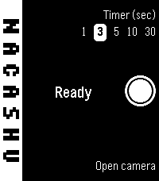
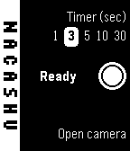
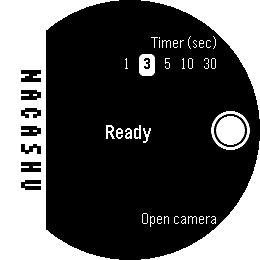

# Nacashu: native camera shutter for Pebble

Nacashu turns a Pebble watch into a remote shutter for your phone's **own** camera app, starting with Pixel Camera. Your camera app still takes the photo, so you keep all of its processing.

```
Watchapp ──AppMessage──▶ Pebble app ──PebbleKit 2──▶ Nacashu (Android)
  SELECT = snap                                      │ accessibility service
  UP     = timer                                     ▼
  DOWN   = open camera ◀── status (vibrate) ──  clicks the camera's shutter button
```

Hold **UP** to cycle the timer through 1, 3, 5, 10 and 30 seconds. The watch shows all of them in a row, with the chosen one on a white pill.

For lefty mode, turn on PebbleOS's own **Settings > Display > Orientation > Left-Handed**, then tick **Lefty** in the phone app so the button labels move to the left (apps can't read the watch setting yet - keep monitoring in https://github.com/Staindk/nacashu/issues/6).

Status: early proof of concept. It works on a Pixel with a Pebble Time 2, including from the lock screen.

| Pebble Time 2 (emery) | Core 2 Duo (flint) | Pebble Round 2 (gabbro) |
|:---:|:---:|:---:|
|  |  |  |

## How it works

- **Watchapp** (`watch/`, C): sends a command when you press a button, and shows and vibrates the result.
- **Pebble app** (Core Devices): forwards the watchapp's messages to the companion app through [PebbleKit 2](https://github.com/pebble-dev/PebbleKitAndroid2), the official Android library for talking to Pebble watchapps.
- **Companion app** (`android/`, Kotlin): an accessibility service finds the camera app's shutter button and clicks it, the same way [TalkBack](https://support.google.com/accessibility/android/answer/6283677) would. TalkBack is Android's built-in screen reader from Google, and it uses this same accessibility API to press buttons for blind and low-vision users. If the camera app is locked or not open, it opens the camera with the standard camera intent.

### Why not simpler approaches?

- **Watch as a Bluetooth selfie stick (HID volume key):** watchapps get no Bluetooth access, and PebbleOS has no HID service. This would need custom firmware.
- **PebbleKit JS on the phone:** the Pebble app's JS sandbox can't control other Android apps.
- **WebHID from PebbleKit JS:** PebbleKit JS isn't a full browser, so it has no WebHID. Even in a browser, WebHID only lets a web page talk *to* a connected device such as a game controller. It can't make the phone act as a keyboard to itself, and Chrome on Android doesn't support it anyway.
- **Sending a volume-key press:** Android doesn't let normal apps inject key events into other apps.

## Small and auditable on purpose

The companion app asks for accessibility access, so it's kept small enough to read in one sitting:

- Its only dependency is the official [PebbleKit 2](https://github.com/pebble-dev/PebbleKitAndroid2) library, and it has no internet permission.
- It only reads the camera app's screen, and only when the watch asks it to press the shutter. During the one-time **Learn my shutter** setup, it shows a see-through layer over your camera and notes where you tap it and which camera button is under that spot. The layer disappears after that one tap, or after a minute.
- The setup screen uses plain Android views, so there's no UI library to read through.

## Layout

```
watch/            Watchapp (Pebble SDK 3). Targets emery (Time 2), flint (Core 2 Duo), gabbro (Round 2).
watch/tools/      fake_phone.py: plays the phone side against the emulator. update_screenshots.py: used by CI.
android/          Companion app (Kotlin, minSdk 29).
docs/             Emulator screenshots, which CI commits to a PR when they change, and icon.png,
                  the 32x32 app icon the Android launcher icon is drawn from.
.github/          CI: builds the .pbw and .apk and takes emulator screenshots, for pull requests and main.
```

## Building

- **Watchapp:** `cd watch && pebble build` (needs [pebble-tool](https://developer.repebble.com/sdk/) and an SDK).
- **Companion:** `cd android && ./gradlew assembleDebug`.
- **CI:** every pull request and every push to `main` produces both files as workflow artifacts.

### Signing

CI signs the companion app with a permanent key, so each new APK installs as an update over the last one. This is already set up: the key lives only in this repo's `NACASHU_KEYSTORE_BASE64` and `NACASHU_KEYSTORE_PASSWORD` secrets, never in the repo itself. Forks and local builds don't have those secrets, so they use the standard Android debug key.

### Build files you might wonder about

These are standard, committed on purpose, and not generated by us:

- **`android/gradlew`, `android/gradlew.bat`, `android/gradle/wrapper/`:** the [Gradle Wrapper](https://docs.gradle.org/current/userguide/gradle_wrapper.html). The scripts (`gradlew` for macOS and Linux, `gradlew.bat` for Windows) and the small `gradle-wrapper.jar` download the exact Gradle version pinned in `gradle-wrapper.properties`, so everyone builds with the same version without installing Gradle. Gradle's docs recommend adding these files to version control, and [Android's build docs](https://developer.android.com/build#wrapper-file) describe the wrapper as "a small application included with your source code". CI checks the jar's checksum against Gradle's published list ([wrapper validation](https://github.com/gradle/actions/blob/main/docs/wrapper-validation.md)).
- **`watch/wscript`:** the Pebble SDK's build script, for the [waf](https://waf.io/) build tool. `pebble build` reads it to compile the watchapp. Ours is the standard one, copied from the PebbleKit 2 sample watchapp.

## Testing

See [TESTING.md](TESTING.md).

## Known gaps

- **Shutter detection.** Pixel Camera works out of the box. For other camera apps, choose the camera in Nacashu, tap **Learn my shutter**, and tap the shutter once on the see-through layer. Nacashu remembers that button, or just that spot on the screen if the camera doesn't expose the button. Please share the view IDs of other cameras (TESTING.md shows how) so they can work out of the box too.

## Trademarks

Pebble is a trademark of its owner. Nacashu is an independent project and isn't affiliated with or endorsed by Core Devices.
