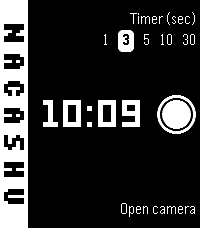
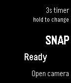
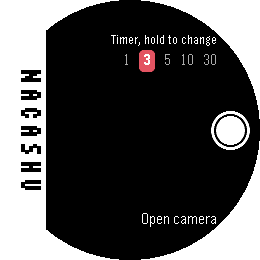
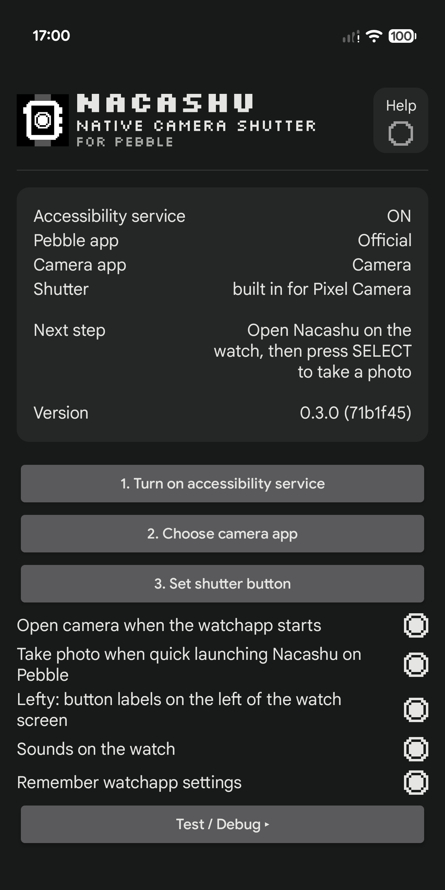

# Nacashu: native camera shutter for Pebble


Nacashu turns your Pebble watch into a remote shutter for your phone's native (or chosen) camera app. The native camera app still takes the photo, so you get to make use of its superior processing.

Status: version 0.3. It works on a Pixel 10 Pro with a Pebble Time 2, including from the lock screen. Other camera apps work after a one-time **Set shutter button**. Not on the Play Store yet.

## Get started

This is the recommended way to install and set up Nacashu. We'll keep it up to date as Nacashu reaches more app stores.

1. Install the watchapp (`.pbw`) and the phone app (`.apk`). Until Nacashu is on the stores, get both from a CI run; [TESTING.md](TESTING.md) walks through it.
2. Open Nacashu on the phone and follow the numbered steps there.
3. Open Nacashu on the watch (allow it in the Pebble app the first time) and press **SELECT**.

## Using the watchapp

| Pebble Time 2 (emery) | Pebble 2 Duo (flint) | Pebble Round 2 (gabbro) |
|:---:|:---:|:---:|
|  |  |  |

| Button | Press | Hold |
|---|---|---|
| SELECT | Take photo(s) | |
| UP | Timer: 0, 3, 5, 10 or 30 s | Reset timer and photo count |
| DOWN | Photos: 1, 3, 5, 10 or ∞ | Open the camera |

Photos in a run are about a second apart, and the watch counts down the timer and up the photos beside the shutter. Press any button to stop a countdown or a run of photos (∞ keeps going until you do). The watch remembers your choices for next time unless you turn off **Remember watchapp settings** in the phone app. While you use the watchapp, it pings the phone every 7 seconds to keep the Bluetooth connection in low-latency mode (otherwise the watch only listens for the phone about every 1.4 seconds, causing long and uneven delays between photos). The pings stop 5 minutes after your last button press.

On watches with a speaker (Pebble Time 2 and Pebble 2 Duo), the timer ticks each second for its last 10 seconds (with a higher pitch for the last two), a shutter click plays when the photo is taken, and a buzz plays when something goes wrong. Turn sounds off by toggling the **Sounds on the watch** setting in the phone app. All of the sounds are made in code: the ticks and buzz are notes in `main.c`, and the shutter click comes from `watch/tools/make_shutter_sound.py`.

For lefty mode, turn on PebbleOS's own **Settings > Display > Orientation > Left-Handed**, then turn on **Lefty** in the phone app so the button labels move to the left (apps can't read the watch setting yet - keep monitoring https://github.com/Staindk/nacashu/issues/6).

To take a photo from any watchface, set Nacashu as a Quick Launch app on the watch (**Settings > Quick Launch**) and turn on **Take photo when quick launching Nacashu on Pebble** in the phone app. Holding that button opens Nacashu, and the phone opens the camera and takes a photo more or less as soon as possible after stabilising to give your camera app a bit of time to focus.

## How it works

<picture>
  <source media="(prefers-color-scheme: dark)" srcset="docs/how-it-works-dark.svg">
  
</picture>

<sub>Diagram source: [docs/how-it-works.mmd](docs/how-it-works.mmd)</sub>

- **Watchapp** (`watch/`, C): sends a command when you press a button, and shows and vibrates the result.
- **Pebble app** (Core Devices): forwards the watchapp's messages to the companion app through [PebbleKit 2](https://github.com/pebble-dev/PebbleKitAndroid2), the official Android library for talking to Pebble watchapps.
- **Companion app** (`android/`, Kotlin): an accessibility service finds the camera app's shutter button and clicks it, the same way [TalkBack](https://support.google.com/accessibility/android/answer/6283677) would. TalkBack is Google's built-in screen reader, and it uses this same accessibility API to press buttons for blind and low-vision users. If the camera app is locked or not open, it opens the camera with the standard camera intent.



### Why not simpler approaches?

- **Watch as a Bluetooth selfie stick (HID volume key):** watchapps get no Bluetooth access, and PebbleOS has no HID service. This would need custom firmware.
- **PebbleKit JS on the phone:** the Pebble app's JS sandbox can't control other Android apps.
- **WebHID from PebbleKit JS:** PebbleKit JS isn't a full browser, so it has no WebHID. Even in a browser, WebHID only lets a web page talk *to* a connected device such as a game controller. It can't make the phone act as a keyboard to itself, and Chrome on Android doesn't support it anyway.
- **Sending a volume-key press:** Android doesn't let normal apps inject key events into other apps.

## Small and auditable on purpose

The companion app asks for accessibility access, so it's kept small enough to read in one sitting:

- The watchapp declares its Pebble app permissions in `watch/package.json` (`"usesPermissions": []`). The only one it gets is exchanging messages with this companion app, which the Pebble app adds because of the `companionApp` entry and asks you to allow.
- Its only dependency is the official [PebbleKit 2](https://github.com/pebble-dev/PebbleKitAndroid2) library, and it has no internet permission.
- It only reads the camera app's screen, and only when the watch asks it to press the shutter. During the one-time **Set shutter button** setup, it shows a see-through layer over your camera and notes where you tap it and which camera button is under that spot.
- The setup screen uses plain Android views, so there's no UI library to read through.
- Before it opens Android's accessibility settings, the app explains what that access is used for and asks you to agree. See also [PRIVACY.md](PRIVACY.md).

## Layout

```
watch/            Watchapp (Pebble SDK 3). Targets emery (Time 2), flint (Pebble 2 Duo), gabbro (Round 2).
watch/tools/      fake_phone.py: plays the phone side against the emulator. update_screenshots.py: used by CI.
                  make_name_images.py: draws the pixel-font app name for the watch and the phone app.
android/          Companion app (Kotlin, minSdk 29).
docs/             Emulator screenshots, which CI commits to a PR when they change, and icon.png,
                  the 32x32 app icon the Android launcher icon is drawn from. how-it-works.mmd is the
                  README diagram's source, exported to the two SVGs next to it.
fastlane/         Google Play store listing: text, icon, feature graphic and screenshots. See RELEASING.md.
.github/          CI: builds the .pbw and .apk and takes emulator screenshots, for pull requests and main.
                  On main it also builds the signed .aab that goes to Google Play.
```

## Building

- **Watchapp:** `cd watch && pebble build` (needs [pebble-tool](https://developer.repebble.com/sdk/) and an SDK).
- **Companion:** `cd android && ./gradlew assembleDebug`.
- **CI:** every pull request and every push to `main` produces both files as workflow artifacts.

CI signs the companion app with a permanent key kept only in this repo's secrets; forks and local builds use the standard Android debug key. See [RELEASING.md](RELEASING.md#signing).

### Build files you might wonder about

These are standard and committed on purpose:

- **`android/gradlew`, `android/gradlew.bat`, `android/gradle/wrapper/`:** the [Gradle Wrapper](https://docs.gradle.org/current/userguide/gradle_wrapper.html), which downloads the exact Gradle version pinned in `gradle-wrapper.properties`. CI checks the jar's checksum against Gradle's published list ([wrapper validation](https://github.com/gradle/actions/blob/main/docs/wrapper-validation.md)).
- **`watch/wscript`:** the Pebble SDK's standard [waf](https://waf.io/) build script, copied from the PebbleKit 2 sample watchapp.

## Testing

See [TESTING.md](TESTING.md).

## Known gaps

- **Shutter detection.** Only Pixel Camera works out of the box; other cameras need the one-time **Set shutter button** step. Nacashu remembers that button, or just that spot on the screen if the camera doesn't expose the button. Please share the view IDs of other cameras (TESTING.md shows how) so they can work out of the box too.
- **Banking apps.** Some banking apps refuse to run while an accessibility service is on, especially one from an app that wasn't installed from the Play Store. If yours does, turn on **Turn accessibility off when I close Nacashu on my watch** under **Test / Debug** in the phone app. To turn the service back on quickly, set up Android's accessibility shortcut (**Settings > Accessibility > Nacashu > Nacashu shortcut**), then hold both volume keys for 3 seconds.

## License

Nacashu is licensed under the [Apache License 2.0](LICENSE).

## Trademarks

Pebble is a trademark of its owner. Nacashu is an independent project and isn't affiliated with or endorsed by Core Devices.
